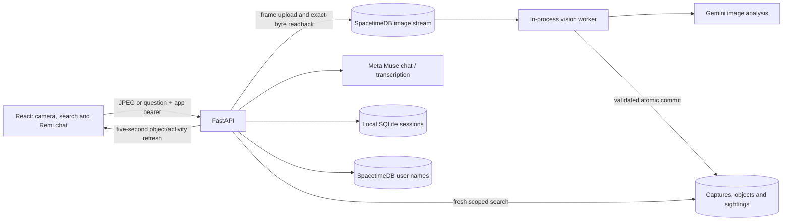

# Current system architecture

Remi is a shared household object finder. The normal stack is React/TypeScript/Vite, Python FastAPI, Meta Muse, Gemini vision and the team's public SpacetimeDB module. SQLite retains API bearer sessions and supports an optional local object-memory mode. The browser and API are served together on Azure through `app_service.py`; Vite proxies the API during development.

## Image and memory workflow

The browser sends one JPEG immediately and then every selected 3/4/5 seconds, default 5. It permits one upload at a time. FastAPI normalizes the image, checks quality and optionally uploads it to the image queue. Remote memory processing verifies the saved bytes before calling `services.worker.pipeline.process_capture`.

Gemini supplies labels, appearance, location descriptions and image boxes. Geometry enrichment adds image zones/relations without local neural-model downloads. Optional model enrichment adds relative depth and crop embeddings. Validated results commit to `vision_capture`, `object_memory` and `object_sighting`. A bounded in-process queue keeps one active analysis and one latest pending frame per scan. It is not a distributed/durable job service.

The API polls/views stored records; uploading a JPEG alone does not prove that recognition or the memory commit succeeded. See [pipeline contract](IMAGE_PIPELINE.md).

## Chat and voice

The interface is Remi, powered by Meta Muse. Chat invokes a read-only household-memory tool and answers from fresh retrieved evidence. Gemini's separate chat adapter remains optional compatibility code. Recorded questions use Meta transcription; browser recognition handles the Remi wake phrase, and browser/device speech synthesis reads replies.

The assistant remains mounted when the chat dialog closes or the user changes app screens. The current camera is mounted only inside the scan dialog, which closes after a completed update. Closing that dialog stops the camera. Both camera and voice stop/ pause when the browser is hidden or closed; neither can be kept recording by a cloud server.

## Identity and permissions

The current browser automatically creates a Pree guest when no stored session exists. **Household members** adds names or selects existing IDs. Sessions last up to 24 hours, with hashes stored in SQLite. Switching profiles issues a new bearer and revokes the previous one. The name-only picker is unverified; everyone joins `demo-home`.

Object observations do not identify who placed an item. The active team module's tables are public; API bearer checks do not make direct database reads private. Table visibility, reducer permissions and permission to publish a module are different concepts. The private invitation/worker module in `spacetimedb/src` is an alternative design, not this runtime schema.

## Coordinates and visual scenes

Boxes are normalized image coordinates `[xmin, ymin, xmax, ymax]`, not world positions. Relative depth rankings apply only within the source image and do not establish meters, camera pose or walking directions. Room views are category-specific SVG illustrations with illustrative pin positions, including a custom-room fallback. Some older object-card confidence/depth badges remain generated presentation values and must not be treated as inference measurements.

The app is not a completed SLAM system. Standalone camera/SLAM experiments are not part of the normal web request path. A saved observation is not proof that an item remains present; old evidence can predate a later location report. Conservative association may create another candidate when labels/appearance change or similar objects cannot be distinguished.

## Hosting boundaries

Use one instance and one API worker while camera jobs are process-local. Azure uses local temporary SQLite sessions under `/tmp/remi`; the public remote user/image/object data stays in SpacetimeDB. Do not put this SQLite WAL database on App Service's persistent network share. A dedicated Vultr host can keep local DATA_DIR outside releases. See [deployment](DEPLOYMENT.md).
