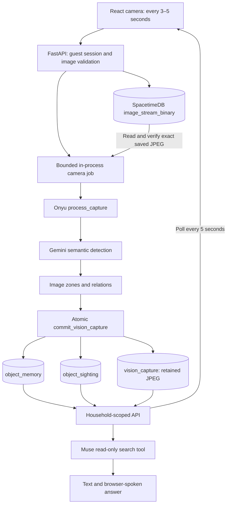

# Connected shared visual memory

Commonplace stores last-seen evidence about household objects: label, appearance, room, location description, normalized box, photo and capture time. It does not store who placed an item or assume an old observation proves its current position.

## Active live path

The live path requires VISION_PROVIDER=gemini, MEMORY_PROVIDER=spacetimedb and CAMERA_FRAME_SINK=spacetimedb. [Setup, schema and verification](LIVE_WORKFLOW.md) describe the published team module. Saved users use its existing public user table through a separate adapter. SQLite retains app session hashes on the host; it does not mirror live object records.

The camera sends one immediate frame, then one every five seconds by default, with selectable 3/4/5-second intervals. One upload is in flight at a time. The API caps images at 1920 pixels and 1 MiB for the queue. Its job scheduler keeps one active analysis and one newest pending frame per scan. The worker reads a server-generated session/sequence reference, verifies the stored bytes and dimensions, and uses those bytes for inference. Upload acceptance and completed memory commits are separate statuses.

The commit reducer validates the complete result batch. It retains the source JPEG, adds sightings, and advances current objects only for newer capture timestamps. Replayed completed frames cannot duplicate history. The API never acknowledges/deletes the shared image queue. Retained evidence does not depend on that queue row remaining present.

## Onyu vision processing

The connected worker is services/worker/pipeline.py, not the standalone RealtimeStreamEngine video prototype. Geometry mode runs Gemini labels, appearance/location text and boxes, then image zones and geometric neighbor relations. It uses conservative unique label/appearance association within a room. Models mode adds optional Depth Anything and SigLIP after installing the spatial extra. Relative depth/rank are absent in geometry mode; monocular relative depth is never converted into invented meters.

Object labels are categories, not verified physical identities. Changed descriptions and ambiguous lookalikes can create new records. Detection absence retains older last-seen information. Bounding boxes refer to the saved photo, not room coordinates or walking directions.

## Shared page and Muse reads

The memory page, history, activity, saved photos and search_household_memory all use the same selected memory adapter. In live mode they read the remote tables. A second browser or a new API process therefore sees the same records. Camera completion is polled separately so the last submitted frame can update the page without waiting for another upload.

Muse Spark handles typed/voice questions through authenticated /api/chat. It must request the read-only memory tool; the backend derives household scope from the guest session. Known single matches receive a grounded explanation; unknown or ambiguous matches get explicit no-match/clarification responses. Each question performs a fresh read. Earlier chat answers remain snapshots, not continuously rewritten state.

Questions, bounded conversation and matching record text/spatial metadata go to Meta. API keys, guest session tokens and photograph bytes are not sent as tool results. Muse Voice Transcribe handles submitted microphone clips; browser/device speech synthesis reads replies aloud. Typed chat remains available. Hello listening depends on an active supported browser and permissions.

## Identity and public prototype boundary

Guest names are unverified. All visitors can intentionally join the shared demo-home prototype. Each new name on the team user table gets a separate anonymous database identity; selecting an existing profile preserves its API ID. The temporary database token is discarded after set_name. The uploader's identity is never reused to rename guests. App bearer sessions are random, hashed in SQLite and expire after 24 hours.

The current image, user and live-memory tables are public for this shared prototype. API household scoping is not private database authentication. The older spacetimedb/ module with private tables, invitations and membership-filtered views is a separate alternative and has not replaced the team's camera module.

## Local development and sample removal

MEMORY_PROVIDER=sqlite retains the basic local detector and local evidence files for isolated tests. SEED_SAMPLE_DATA=false is the default: no placeholder objects/members are created and old sample sightings are hidden without deleting them. Tests explicitly opt into sample fixtures when needed. Sample-capture and fixed-profile endpoints are unavailable in the normal sample-free workflow.

## Hosting and remaining work

[Vultr hosting](DEPLOYMENT.md) serves React through Nginx and runs one FastAPI process under systemd. Local sessions live in an absolute persistent DATA_DIR; shared object data and evidence remain in SpacetimeDB across code releases. Model credentials stay on the backend.

Camera and Muse stay mounted across household pages, but hiding/leaving the website or suspending the phone stops media. The cloud cannot continue capturing from a closed browser. An already received frame may still finish processing.

The current scheduler is not a durable leased-job service. API restarts lose pending work, do not backfill historical queue images and require the next active camera frame. Concurrent first sightings can still create provisional duplicate identities. Durable jobs, retention, stronger identity association and scoped real-time subscriptions remain future work. Full SLAM, metric navigation and closed-browser capture are outside this workflow.
