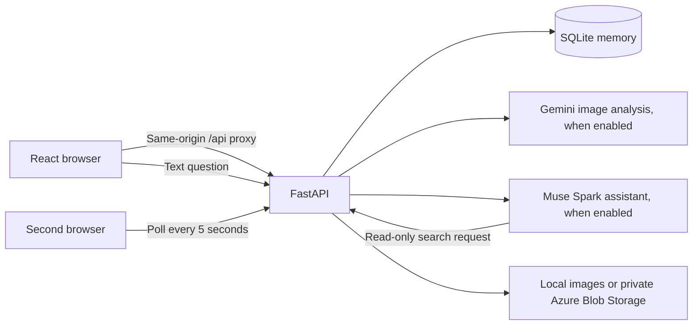
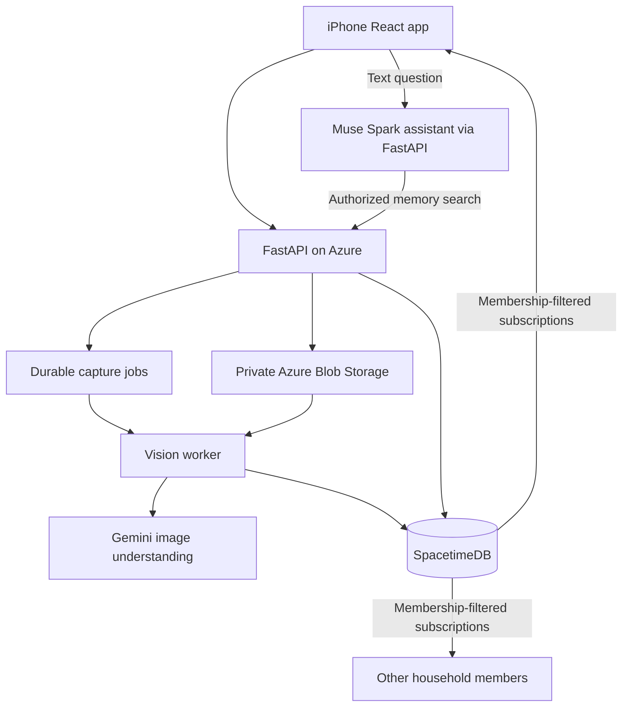

# Architecture and implementation boundary

Commonplace remembers evidence about shared objects. It reports a last-seen location or an explicit member statement, rather than assuming an object's current physical position.

## Runnable local path

The sample path uses an original illustration with known boxes and a separate sample-capture endpoint. The real-capture path refuses to run in sample vision mode. The seed stays labeled as sample data even after Gemini is enabled.

**The user-facing agent is now Meta Muse Spark inside the React app.** Chat goes to authenticated `POST /api/chat`; Muse requests `search_household_memory(q)`, and FastAPI executes the same household-scoped lookup used by the optional connector endpoint. Only the session selects the household. There is no browser-to-Meta key or direct model-to-database access.

Each successful memory answer performs one fresh read through the model's search request. Meta supports `tool_choice: "auto"`; if it fails to request the allowed lookup, the backend reports an error rather than accepting an ungrounded location. Known single matches use a second model request to explain evidence; unknown/ambiguous results use deterministic no-match/clarification messages. A turn has at most two model requests and no automatic retries. The model response's encrypted reasoning items are preserved during that tool exchange. Previous chat text is bounded context for resolving follow-ups, never authoritative location evidence. Evidence cards show the actual retrieved source/time even if an answer is imperfect.

Chat is read only; location/found updates still use the existing member controls. It sends questions, bounded recent conversation, and matching record text to Meta, not photograph bytes or session credentials. Chat history is temporary per mounted assistant/profile. It is not the shared durable memory, which remains in SQLite. Muse Voice Transcribe handles microphone speech-to-text; the browser/device speech service reads replies aloud. Typed chat remains available. No Gemini Live session is used.

## Intended cloud path

The second diagram is the target, not a claim that the first scaffold has been deployed or switched to SpacetimeDB. Cloud persistence needs only SpacetimeDB plus object storage; SQLite can be removed when that integration is complete.

The external consumer Muse connector gateway remains optional. The active assistant calls Meta Model API directly. The manual Meta API smoke test verifies account access only.

## Evidence and identity

- Objects have stable IDs; categories such as “keys” are not unique identities.
- Each photo capture creates separate candidate IDs until a person or a reliable association process confirms identity.
- Visual observations store their own room, surface description, source image, normalized box, contributor, and observation time.
- Member reports are separate observations with no fabricated photograph or box.
- The latest location is ordered by observation time, not inference completion time.
- An older photo is retained as earlier evidence after a member reports a new location.
- Absence from a later frame does not establish movement or removal.
- Bounding boxes are image coordinates, not metric 3D positions.

## Authorization

The local API derives the household and contributor from the bearer session; request payloads cannot select an arbitrary household or actor. Session tokens are random and hashed at rest. All memory reads, image reads, and updates are household-scoped.

Demo profile selection is intentionally public for local development. That is not an end-user authentication solution. It must be replaced before public deployment.

The separate SpacetimeDB module keeps source tables private. Subscribers use identity-scoped views. Owners issue single-use invitations and explicitly grant a separate worker identity permission to create visual evidence. Members can report locations but cannot label their own statements as Gemini observations.

## Deliberate simplifications

The starter uses explicit capture instead of continuous sampling, synchronous inference instead of a background queue, token/alias search instead of embeddings, and browser polling instead of subscriptions. These make the first end-to-end flow reviewable and testable without cloud credentials.

The capture API supports caller-supplied request IDs and atomically deduplicates result commits. Simultaneous duplicate requests can still both consume inference before one result wins the commit. Worker leasing should remove that waste in the asynchronous version. A storage write that succeeds immediately before a failed database commit can leave an orphan image; cleanup and retention belong with that worker milestone.

## Independent Muse playground

`make muse-api` starts `assistant_lab.py` on loopback port 8002. `/` always renders the household homepage; no launch flag redirects it. `/muse` is a temporary independent assistant test route that shares `HouseholdLayout` and `AssistantPanel` with the integrated app. `/api/lab/*` is proxied to port 8002 separately from household `/api/*` on port 8000. The test route never mounts the household App or attempts household login. It never imports `main.py`, `Store`, vision, or image storage. Plain chat uses one Meta Responses request per send and has no memory tools. `/api/lab/transcribe` sends a validated in-memory WAV clip to Meta's ASR endpoint. The normal `/api/chat` and authenticated `/api/voice/transcribe` remain part of the full app. Both use server-held Meta credentials.

The lab is development-only, rejects foreign browser origins/hosts, and must stay local. It is not the production authentication solution. Recordings stop at 29 seconds in the UI, are converted to mono 24 kHz PCM WAV, and are limited to 30 seconds/2 MiB by the backend. Text/transcripts and matching records are sent to Meta; local conversation state is lost on reload. Browser speech synthesis may use the operating system's speech service. Device/browser permissions and audio playback are manual acceptance checks.

The **Talk to Muse** session uses local RMS-based speech/pause detection (about 1.3 seconds of silence after speech) to end each microphone turn automatically. Only actual detected speech is uploaded; empty listening times out after eight seconds. Each turn follows transcription → chat → browser speech playback → a fresh listening turn. The microphone is closed during processing and playback. A stop/visibility-change cancels the session; generation IDs and aborted requests prevent a late transcript from submitting another question. Playback failures pause the session. Manual dictation and typed chat remain available. The optional `useWakePhrase` hook adds opt-in, foreground “Hello” activation through browser speech recognition. That recognizer may use a remote browser-vendor service; no local-only recognition is promised. It pauses during recording, processing, and playback, acknowledges activation aloud, and returns to wake standby after a reply. Inline commands use the final browser transcript; separate questions use Meta ASR. Unrelated wake transcripts do not reach our API. Permission failures or repeated rapid browser ends disable wake listening. Hiding/leaving the page and Escape stop voice and wake activity. This is page-scoped turn-taking, not an OS/background listener or full-duplex voice interruption. See [accessible voice design](ACCESSIBILITY.md).
