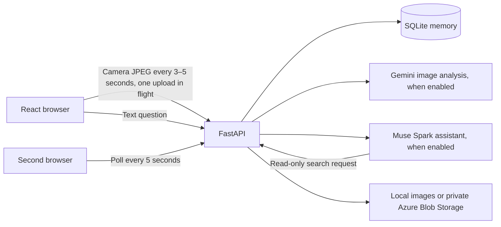
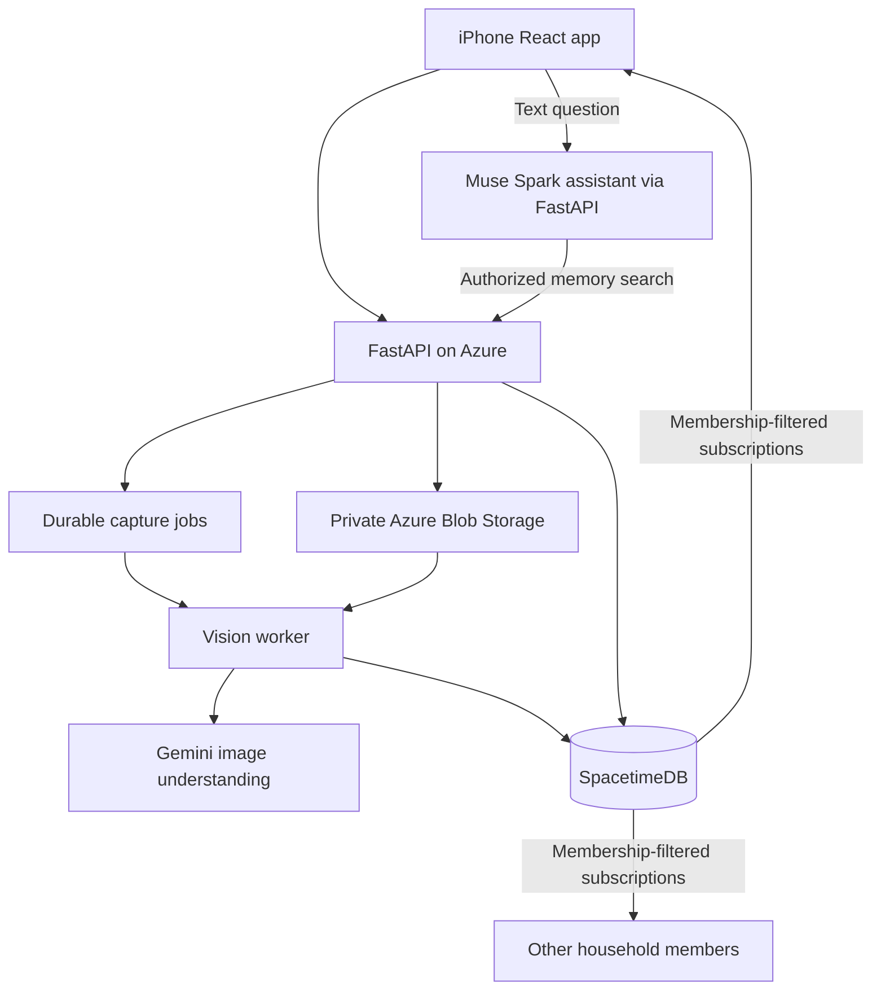

# Architecture and implementation boundary

Commonplace remembers evidence about shared objects. It reports last-seen locations with images, boxes, source, and time. It does not record who placed an item or assume that an old observation is its current physical position.

## Runnable local path

The sample path seeds an original illustration with known boxes; the legacy sample-capture endpoint remains for fixtures, without a manual add button. The real-capture path refuses to run in sample vision mode. The seed stays labeled as sample data even after Gemini is enabled.

The `/camera` page and Scan room dialog share one React camera component. It ports the Fieldframe controls and reuses the original OpenCV quality selector. Camera-only mode sends authenticated `POST /api/camera/frames` requests, keeps bounded temporary top-three diagnostics, and makes no model calls or object-memory writes. Shared-memory mode also uses `/api/camera/frames` with quality diagnostics plus asynchronous Gemini analysis. Both modes use the existing HTTP proxy and capture every 3–5 seconds, defaulting to 5 seconds; memory mode feeds a backend worker with one latest pending frame and at least the selected interval after each result; the original standalone WebSocket prototype is retained separately. See [camera integration](LIVE_SCAN.md).

**The user-facing agent is now Meta Muse Spark inside the React app.** Chat goes to authenticated `POST /api/chat`; Muse requests `search_household_memory(q)`, and FastAPI executes the same household-scoped lookup used by the optional connector endpoint. Only the session selects the household. There is no browser-to-Meta key or direct model-to-database access.

Each successful memory answer performs one fresh read through the model's search request. Meta supports `tool_choice: "auto"`; if it fails to request the allowed lookup, the backend reports an error rather than accepting an ungrounded location. Known single matches use a second model request to explain evidence; unknown/ambiguous results use deterministic no-match/clarification messages. A turn has at most two model requests and no automatic retries. The model response's encrypted reasoning items are preserved during that tool exchange. Previous chat text is bounded context for resolving follow-ups, never authoritative location evidence. Evidence cards show the actual retrieved source/time even if an answer is imperfect.

Chat is read only; foreground room scanning writes automatic location updates. Object details show evidence/history without manual entry controls. It sends questions, bounded recent conversation, and matching record text to Meta, not photograph bytes or session credentials. Chat history is temporary per mounted assistant/profile. It is not the shared durable memory, which remains in SQLite. Muse Voice Transcribe handles microphone speech-to-text; the browser/device speech service reads replies aloud. Typed chat remains available. No Gemini Live session is used.

## Intended cloud path

The second diagram is the target, not a claim that the first scaffold has been deployed or switched to SpacetimeDB. Cloud persistence needs only SpacetimeDB plus object storage; SQLite can be removed when that integration is complete.

The external consumer Muse connector gateway remains optional. The active assistant calls Meta Model API directly. The manual Meta API smoke test verifies account access only.

## Evidence and identity

- Object categories such as “keys” are not unique physical identities.
- Adjacent frames can reuse an ID only for an exact normalized room, label, and nonempty appearance that occurs once in both frames, in the same household/scan, within 60 seconds. This is provisional association, not verified identity.
- Ambiguous detections, description changes, scan restarts, and room changes create new candidates. Missing detections retain older last-seen records; absence does not prove removal.
- Visual observations store room, surface description, source image, normalized box, and observation time, without a contributor identity.
- Legacy location reports remain readable with source `reported`, no fabricated image/box, and no exposed actor fields. New observations use an empty legacy actor column; existing historical actor values are not erased by this change.
- The latest location is ordered by backend receipt time before inference, not inference completion time. Older results within one scan are marked superseded.
- Bounding boxes are image coordinates, not metric 3D positions. A saved box is displayed only on its saved image.

See [the live scan contract and testing guide](LIVE_SCAN.md) for lifecycle and association limits.

## Authorization

The local API derives the authorized household from the bearer session; request payloads cannot select an arbitrary household. The session authorizes uploads without adding a person to the resulting observation. Session tokens are random and hashed at rest. All memory reads, image reads, and updates are household-scoped.

The prototype uses `POST /api/guest/session` with either a new display name (trimmed, 1–50 characters) or an existing `user_id` from `GET /api/guest/users`. Creating a user allocates a new UUID; selecting one preserves its ID and starts a fresh random 24-hour session. Switching guests revokes the provided old token; leaving via `DELETE /api/guest/session` revokes the current token. The browser stores it in `sessionStorage` and returns to the picker after expiry or logout. Guest names are for session selection, not object attribution.

`guest_profiles.py` provides an independent profile registry: temporary process memory by default, optional local SQLite persistence, or private SpacetimeDB profile storage. Auto mode uses temporary users if no server token is supplied or the configured database returns 404. Other database errors are reported. Backend restart resets temporary selectable profiles and rejects their old sessions; it does not erase image/object history or legacy actor values in old rows. Shared-memory responses strip actor IDs/names, including for old records. SpacetimeDB profiles are read over the HTTP SQL API with a backend-held owner token and written through the owner-checked `create_guest_profile` reducer. Session hashes and object observations remain in SQLite; selecting a remote profile maps its stable ID into the local members table for session lookup. See [user storage setup](USERS.md).

All visitors can join this one demo household. These tokens scope API requests; guest names do not prove identity or authorize entry to a private home. No app subscription, email verification, password, or external login provider is needed. `APP_ENV=prototype` explicitly permits this demo mode; `APP_ENV=production` remains unavailable until a future private-account implementation. The fixed-profile endpoint remains a development compatibility endpoint and returns 404 in prototype mode.

The separate SpacetimeDB module keeps source tables private. Subscribers use identity-scoped views. Owners issue single-use invitations and explicitly grant a separate worker identity permission to create visual evidence. Members can report locations but cannot label their own statements as Gemini observations.

## Deliberate simplifications

Camera and Muse controllers persist across household screens and attempt activation by default with browser permissions. Navigation uses the History API instead of full reloads. Captures run every 3–5 seconds (default 5 seconds), skip busy ticks, and feed a bounded in-process backend vision worker. Internal screen changes keep capture running; hiding or leaving the website stops media and requests cancellation. An already-received frame may still commit. See [persistent assistance](ASSISTANCE_SESSION.md). It uses token/alias search instead of embeddings and browser polling instead of subscriptions. These make the first end-to-end flow reviewable and testable without cloud credentials.

The capture API supports caller-supplied request IDs and atomically deduplicates result commits. Simultaneous duplicate requests can still both consume inference before one result wins the commit. Worker leasing should remove that waste in the asynchronous version. A storage write that succeeds immediately before a failed database commit can leave an orphan image; cleanup and retention belong with that worker milestone.

## Integrated Ask Muse

The household app mounts one `AssistantPanel` and shared voice hooks for the active guest. Navigation changes the displayed screen while chat, camera, and voice state stay mounted. `make api` serves authenticated `/api/chat` and `/api/voice/transcribe` on port 8000; `make web` proxies `/api` to that backend. Muse searches household-scoped evidence through a read-only tool, using server-held Meta credentials. Transcription validates an in-memory WAV clip before sending it to Meta ASR; spoken answers use browser/device speech synthesis.

The standalone assistant page and backend have been retired. Old page bookmarks redirect to the integrated Ask Muse view, which requires guest entry. Local testing uses the same household flow with automatically initialized SQLite memory and can disable hosted storage and Gemini.
