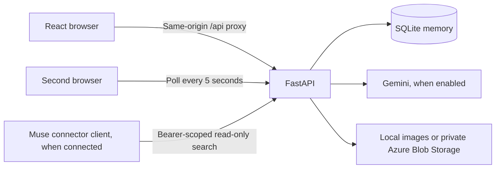
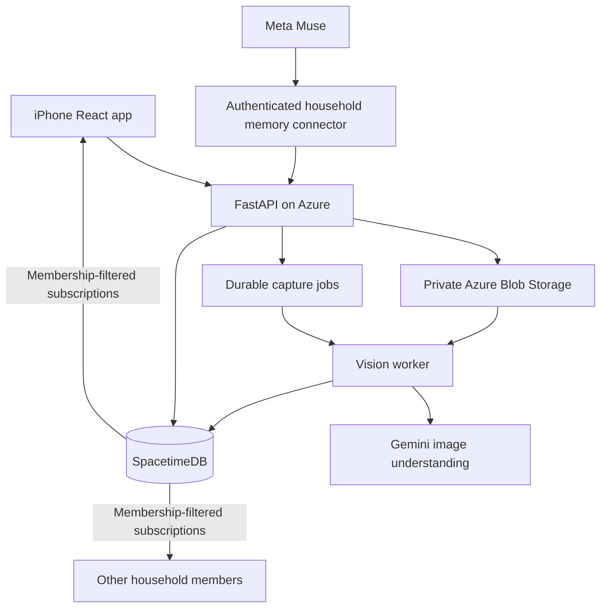

# Architecture and implementation boundary

Commonplace remembers evidence about shared objects. It reports a last-seen location or an explicit member statement, rather than assuming an object's current physical position.

## Runnable local path

The sample path uses an original illustration with known boxes and a separate sample-capture endpoint. The real-capture path refuses to run in sample vision mode. The seed stays labeled as sample data even after Gemini is enabled.

## Intended cloud path

The second diagram is the target, not a claim that the first scaffold has been deployed or switched to SpacetimeDB. Cloud persistence needs only SpacetimeDB plus object storage; SQLite can be removed when that integration is complete.

## Evidence and identity

- Objects have stable IDs; categories such as “keys” are not unique identities.
- Each photo capture creates separate candidate IDs until a person or a reliable association process confirms identity.
- Visual observations store their own room, surface description, source image, normalized box, contributor, and observation time.
- Member reports are separate observations with no fabricated photograph or box.
- The latest location is ordered by observation time, not inference completion time.
- An older photo is retained as earlier evidence after a member reports a new location.
- Absence from a later frame does not establish movement or removal.
- Bounding boxes are image coordinates, not metric 3D positions.

## Authorization

The local API derives the household and contributor from the bearer session; request payloads cannot select an arbitrary household or actor. Session tokens are random and hashed at rest. All memory reads, image reads, and updates are household-scoped.

Demo profile selection is intentionally public for local development. That is not an end-user authentication solution. It must be replaced before public deployment.

The separate SpacetimeDB module keeps source tables private. Subscribers use identity-scoped views. Owners issue single-use invitations and explicitly grant a separate worker identity permission to create visual evidence. Members can report locations but cannot label their own statements as Gemini observations.

## Deliberate simplifications

The starter uses explicit capture instead of continuous sampling, synchronous inference instead of a background queue, token/alias search instead of embeddings, and browser polling instead of subscriptions. These make the first end-to-end flow reviewable and testable without cloud credentials.

The capture API supports caller-supplied request IDs and atomically deduplicates result commits. Simultaneous duplicate requests can still both consume inference before one result wins the commit. Worker leasing should remove that waste in the asynchronous version. A storage write that succeeds immediately before a failed database commit can leave an orphan image; cleanup and retention belong with that worker milestone.
