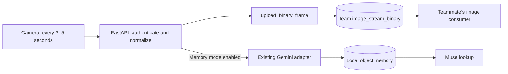

# Connect the camera to the team's image database

The camera can forward normalized JPEGs through the existing `upload_binary_frame` reducer on the team's SpacetimeDB database. This is a separate connection from the guest registry and from retained evidence images.



## Configured databases

| Purpose                  | Configuration                   | Database                                                           |
| ------------------------ | ------------------------------- | ------------------------------------------------------------------ |
| Saved guests             | `SPACETIMEDB_DATABASE`          | Your separate users-only registry                                  |
| Captured frame delivery  | `CAMERA_SPACETIMEDB_DATABASE`   | `c2005dfa977b978871c77ab400a529efd494fce3e8d3d60c2aa786050f6ebd02` |
| Retained object evidence | `STORAGE_PROVIDER` + `DATA_DIR` | Existing local images/SQLite, or the Azure image adapter           |

Do not replace your guest database ID with the image database ID. Each connection has its own credential setting. A database ID identifies a destination; it does not grant upload permission.

## Upload access

Both upload reducers accept anonymous requests. Both image tables are publicly readable; acknowledgment/deletion still requires the configured backend identity. Frame validation remains enforced. The API only appends frames and never acknowledges or deletes them.

## Root `.env`

The image database address has been added separately. The code defaults to disabled delivery. Enable delivery with these settings:

```dotenv
CAMERA_FRAME_SINK=spacetimedb
CAMERA_SPACETIMEDB_URL=https://maincloud.spacetimedb.com
CAMERA_SPACETIMEDB_DATABASE=c2005dfa977b978871c77ab400a529efd494fce3e8d3d60c2aa786050f6ebd02
CAMERA_SPACETIMEDB_TOKEN=
```

Leave `CAMERA_SPACETIMEDB_TOKEN` empty for anonymous uploads and restart `make api`. Keep your existing `SPACETIMEDB_*` guest settings. `GUEST_PROFILE_STORE` accepts only `auto`, `local`, `sqlite`, or `spacetimedb`; `GUEST_PROFILE_STORE=local make api` is a **terminal command**, not a value to put in `.env`.


No Gemini key is required to test image delivery alone. To also run the app's existing Gemini memory analysis, configure:

```dotenv
VISION_PROVIDER=gemini
GEMINI_VISION_API_KEY=YOUR_VISION_KEY
GEMINI_MODEL=YOUR_IMAGE_CAPABLE_MODEL_ID
```

Keep `ASSISTANT_PROVIDER=muse` and your Meta credentials for Muse. If your teammate's image consumer already calls Gemini, coordinate which worker should perform inference to avoid processing the same frame twice.

## Test through the camera

1. Run `make api` and `make web` in separate terminals, then join the app.
2. Open Camera. With upload delivery enabled, its summary shows **Sharing with your household**. Stop the camera before selecting a mode.
3. Choose **Share camera view only** to test delivery independently. Select **Share camera view**. The default is one immediate frame followed by one every five seconds; choices remain 3/4/5 seconds.
4. Wait for **Your latest view has been shared**. Select **Stop sharing camera** after the test. Your database teammate can inspect the queue/consumer using their own access. A frame may already have been consumed and acknowledged by their worker.
5. For the app's local vision/memory path, select **Update shared memory**, start scanning, wait for the memory update, then confirm objects/evidence in Our memory and ask Muse about one.

`GET /api/health` reports `camera_frame_sink`. Each successful `POST /api/camera/frames` includes `image_upload: {provider: "spacetimedb", state: "uploaded", session, sequence}` when delivery is enabled. An upload confirmation means the reducer accepted the frame; it does not confirm the teammate's vision processing or result persistence.

Upload-only mode sends images to the shared database while keeping this app's Gemini calls and object-memory writes off. With delivery disabled, preview retains its existing temporary quality-check behavior.

## Handoff contract

The adapter calls the [HTTP reducer endpoint](https://spacetimedb.com/docs/http/database/) with this ordered JSON argument array:

```text
[session, sequence, capturedUs, width, height, jpeg]
```

- `session`: first 32 hexadecimal characters of SHA-256 over Python `json.dumps([household, scan_id])` encoded as UTF-8; stable per household/scan and compatible with the reducer.
- `sequence`: one-based count within the current diagnostic scan state.
- `capturedUs`: Unix receipt timestamp in microseconds, before upload/inference.
- `width`, `height`: dimensions of the normalized JPEG; EXIF rotation is applied.
- `jpeg`: normalized JPEG bytes as a JSON array of integers from 0 to 255; stored as binary bytes.

The backend does not retry ambiguous failures automatically. Access, network, and reducer failures stop the camera with an actionable error; Gemini is not started for a failed upload. This connector adds no durable delivery queue or exactly-once guarantee. If scans are resumed after server state expires, consumers should not assume session/sequence alone is a permanent unique key.

This integration covers the live-camera `/api/camera/frames` route. The legacy synchronous `/api/captures` route retains its existing behavior. Raw frames in the team's stream are an ingestion queue, not a replacement for saved evidence-image storage.

The teammate's processed JSON is **not imported back into the app's object memory yet**. That needs an agreed result schema, object IDs, image references, household scope, and a result-consumer/storage adapter. The app's current optional Gemini path still updates SQLite and uses its configured evidence image store. The optimized depth/embedding branch is a separate integration.

## Azure and verification

Configure these `CAMERA_*` settings on the Azure backend. The uploader token may remain empty for this anonymous-upload prototype. Other service keys remain separate; no database CLI is needed at runtime.

Automated tests mock the image database and Gemini and verify upload parameters, credential separation, errors, no acknowledgement calls, and continued image/memory behavior. Browser tests cover the upload-only controls and distinguish upload confirmation from vision completion. Test servers explicitly disable real frame delivery so tests do not upload fixtures to the team's database.
