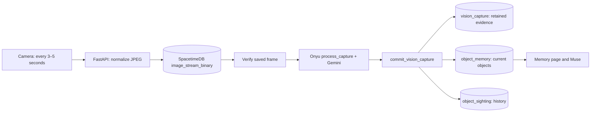

# Live image and shared-memory pipeline

The camera and object-memory workflow is now connected. Follow [the full workflow and testing guide](LIVE_WORKFLOW.md) for configuration, tables, Onyu's processing, and Muse verification.



## Required settings

```dotenv
VISION_PROVIDER=gemini
MEMORY_PROVIDER=spacetimedb
CAMERA_FRAME_SINK=spacetimedb
SEED_SAMPLE_DATA=false
VISION_ENRICHMENT=geometry
CAMERA_SPACETIMEDB_URL=https://maincloud.spacetimedb.com
CAMERA_SPACETIMEDB_DATABASE=c2005dfa977b978871c77ab400a529efd494fce3e8d3d60c2aa786050f6ebd02
```

Keep the tested `GEMINI_VISION_API_KEY` / `GEMINI_MODEL` and Muse settings in the backend `.env`. The three new memory tables and commit reducer were published to this database with approval. Saved guests still use its existing `user` table through their separate adapter. The API no longer reads local sample objects when remote memory is selected.

The current prototype upload and commit reducers accept public access. An optional `CAMERA_SPACETIMEDB_TOKEN` remains backend-only. The app never acknowledges or deletes queue rows. Images that contribute to a completed capture are retained in `vision_capture`, so evidence does not disappear if another authorized consumer removes its queue source later.

## Upload contract

`upload_binary_frame` receives the ordered [HTTP reducer arguments](https://spacetimedb.com/docs/http/database/):

```text
[session, sequence, capturedUs, width, height, jpeg]
```

`session` is a stable 32-character hexadecimal hash of the household and scan ID. `sequence` is one-based. `capturedUs` is the API receipt time in microseconds. The JPEG is resized to at most 1920 pixels on either side and compressed to at most 1 MiB before dimensions are measured. Its SATS JSON representation is a hexadecimal string; the table stores binary bytes. Integer arrays caused gateway failures for larger frames; see the [SpacetimeDB byte serializer](https://github.com/clockworklabs/SpacetimeDB/blob/master/crates/sats/src/ser/serde.rs).

The worker reads that exact session/sequence from the database and verifies dimensions and SHA-256 before Gemini sees it. It does not infer from an older diagnostic top-ranked photo or silently substitute a placeholder.

## What each status means

| Status                    | Meaning                                                               |
| ------------------------- | --------------------------------------------------------------------- |
| Latest view shared        | Image upload accepted; recognition may still be pending               |
| Updating shared memory    | Selected frame is being analyzed/committed                            |
| Updated N visible objects | Validated observations were committed to the configured memory store  |
| No items clear enough     | Successful empty detection result; no invented objects                |
| Analysis error            | Vision/readback/commit failed; no successful memory update is claimed |

Select **Update shared memory** on Camera to invoke recognition. **Share camera view only** intentionally uploads without adding objects. The camera captures every 3–5 seconds, defaults to five, and skips busy upload ticks. The backend keeps one active inference and one newest pending frame per scan. The UI polls completion separately from upload and refreshes household memory every five seconds.

## Verification and troubleshooting

```bash
.venv/bin/python scripts/check_pipeline.py
```

This read-only command identifies disabled vision, the wrong object-memory provider, missing tables and a missing commit reducer. It makes no model calls or database writes.

If upload succeeds but no objects appear: check memory mode, `VISION_PROVIDER=gemini`, `MEMORY_PROVIDER=spacetimedb`, and the analysis status. Inspect `vision_capture` to distinguish a completed empty frame from an unprocessed queued image. New configuration needs an API restart and a fresh camera session. `VISION_PROVIDER=demo` never runs Gemini even when a key exists.

“Invalid JPEG frame” is a reducer validation error. Restart the API with the current normalization/hex encoding fix, then stop/start Camera. A successful upload does not prove successful vision; look for the separate completed-memory status.

## Remaining limits

The worker is in-process, not a durable leased queue. Restarting the API loses pending jobs and does not backfill every historical frame. No automatic retries consume extra model calls after a failure. The next active camera frame can continue the workflow. The optional standalone SLAM/video prototypes are not the web app's worker.

For local compatibility tests, `MEMORY_PROVIDER=sqlite` keeps the basic legacy detector and local evidence files. Samples are off by default; explicitly enable `SEED_SAMPLE_DATA=true` only for a separate test dataset. Old sample rows are hidden without deleting them when samples are off.
