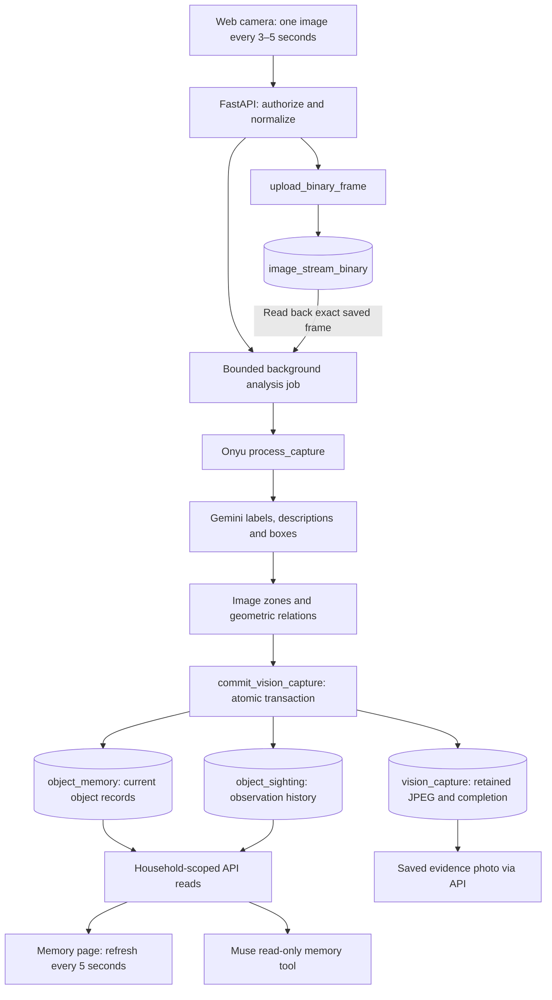

# Camera → database → Onyu/Gemini → shared memory → Muse

## What was missing

The image upload worked, but ended at `image_stream_binary`. Uploading an image does not itself invoke Gemini. The web app called the old basic detector only in memory mode, Onyu's `services/worker/pipeline.py` was not imported by that path, and its JSON had no storage adapter. The memory page and Muse continued reading SQLite. The hosted database had only `user`, `message`, `image_stream` and `image_stream_binary`, with no processed-object tables. The local `.env` also had `VISION_PROVIDER=demo`.

## Connected implementation



The API sends an uploaded-frame reference to its existing in-process job scheduler. The job checks for an already completed capture, reads the saved image from SpacetimeDB, verifies its dimensions and SHA-256 against the received frame, and runs Onyu's pipeline once on those bytes. It does not substitute an older sharp frame.

The commit reducer validates the whole batch and copies the source JPEG into `vision_capture`, then saves the current objects and history atomically. A completed capture is idempotent; older observations can add history but cannot replace a newer current location. Queue images and existing users/messages are never acknowledged, deleted or renamed by this path. Retained evidence survives a separate consumer acknowledging the original queue frame.

Both the memory page and `search_household_memory` read the same remote object records when `MEMORY_PROVIDER=spacetimedb`. Muse receives stored descriptions, source/time and spatial metadata; it does not run computer vision itself. A second phone or a new API process reads the same objects. Local SQLite still stores app session hashes; it is not the live object-memory store in this mode.

## Publish the new tables first

The additive source change is [camera_capture/stream_module/src/index.ts](../camera_capture/stream_module/src/index.ts). It adds:

| Table/reducer           | Purpose                                                                        |
| ----------------------- | ------------------------------------------------------------------------------ |
| `vision_capture`        | Retained processed-frame JPEG, dimensions, receipt time, room and object count |
| `object_memory`         | Latest structured object record and optional matching embedding                |
| `object_sighting`       | Historical location, bounding box, photo reference and spatial metadata        |
| `commit_vision_capture` | Validate and atomically commit one frame's observations                        |

These are public tables for the existing name-only shared prototype. They are not private household authentication. The existing user/message/image table schemas and their original reducers are unchanged in the source diff. Publishing still replaces the shared module, so it needs team management access and an explicit deployment decision; `--delete-data=never` prevents a destructive data-reset fallback but does not prove all clients are compatible.

**Published on October 24, 2026 after explicit approval.** SpacetimeDB reported an additive migration creating only these three tables. Existing table schemas were preserved and no data reset was used. For a fresh environment, the database maintainer can publish the same tested source from the repository root:

```bash
node_modules/.bin/tsc --noEmit -p camera_capture/stream_module/tsconfig.json
npm run test:module
spacetime publish --server maincloud --module-path camera_capture/stream_module --no-config --delete-data=never home-object-finder-i72wg
```

Do not publish the unrelated `spacetimedb/` or users-only module over the image database. Do not reset the database if the additive update reports incompatibility. SpacetimeDB tables are declared by the module; the app cannot create them using SQL `CREATE TABLE`. Once published, normal API restarts do not republish or recreate them.

## Activate after publication

Keep your existing model keys in the root `.env`. Change/add:

```dotenv
VISION_PROVIDER=gemini
MEMORY_PROVIDER=spacetimedb
CAMERA_FRAME_SINK=spacetimedb
SEED_SAMPLE_DATA=false
VISION_ENRICHMENT=geometry
```

The image and memory tables use `CAMERA_SPACETIMEDB_URL` / `CAMERA_SPACETIMEDB_DATABASE`. Saved-user configuration stays independent. `ASSISTANT_PROVIDER=muse`, `MODEL_API_KEY`, `META_MODEL`, `GEMINI_VISION_API_KEY` and `GEMINI_MODEL` remain backend-only settings.

`geometry` runs the actual Gemini detection adapter plus Onyu's box-zone and relation logic without installing large local models. Exact, unique label/appearance matches can reuse IDs; this is provisional association, not proof that two visually similar objects are identical. Ambiguity creates separate objects. Relative depth/rank are absent in this mode; no depth or distance is invented.

To enable Onyu's optional Depth Anything and SigLIP stages, install the extra and change the setting:

```bash
.venv/bin/python -m pip install -e 'services/api[spatial]'
```

```dotenv
VISION_ENRICHMENT=models
```

First inference downloads model weights and requires extra RAM/disk/time. Relative monocular depth stays relative to its photo; it is not metric navigation. Those optional models have not been downloaded or tested against this machine's hardware by this integration.

## Test the full UI

```bash
.venv/bin/python scripts/check_pipeline.py
make api
```

Run `make web` in another terminal. The diagnostic script checks configuration and the hosted schema without making model calls or writing data.

1. Refresh the app and join with a guest name. With sample data off, an empty household shows no fabricated objects. Old sample rows are hidden, not deleted.
2. Stop any existing camera session. Choose **Update shared memory**, then **Start scanning**. The default mode selects memory when Gemini is enabled; capture defaults to five seconds.
3. Keep a distinctive household object in view. An upload confirmation proves only that the image was saved. The UI separately polls analysis completion and shows **Updated N visible objects in shared memory** only after the commit succeeds. No detections is a valid empty result, not an excuse to insert example objects.
4. In SpacetimeDB, inspect `vision_capture`, `object_memory` and `object_sighting`. A saved raw frame without a `vision_capture` entry has not completed analysis.
5. Open **Our memory**, or a second browser/phone, and verify the actual labels, location and saved photo. The page polls every five seconds, independently of capture. Ask Muse about one object; its answer should cite that stored last-seen information.
6. Move the object and wait for a completed frame. Its latest location should change; prior sightings remain in history. Stop the camera before ending a paid model test.

**Share camera view only** intentionally skips Gemini and object-memory writes. Select memory mode for this workflow. A newly uploaded image is not a continuously updated video feed for Gemini: each selected image is a separate inference request. Slow inference keeps only the newest pending frame instead of accumulating an unbounded queue.

## Boundaries and verification

The API scheduler is still in-process. Restarting it loses pending jobs; it does not backfill every historical image in the shared queue. The next active camera frame continues processing. A durable leased-job runner and retention policy remain later work. The app uses polling rather than SpacetimeDB browser subscriptions.

Automated tests exercise upload → exact-byte readback → the actual Onyu pipeline/Gemini adapter → atomic commit transport → a second guest's memory → Muse, with external services mocked. SDK module tests check the real reducer's atomic validation, idempotence, retained JPEGs, history, and rejection of older latest updates while preserving original tables. Browser tests check scan completion and empty live views.

Live verification on October 24, 2026:

- The hosted migration created the three new tables without resetting existing data.
- A stored real camera frame ran through Onyu/Gemini and committed six detected objects, history and retained evidence. Its original capture timestamp was preserved.
- The running frontend API returned six real object records and served the saved image successfully.
- The actual browser memory page displayed six cards with no sample cards.
- Live Muse requests returned HTTP 200 and retrieved stored vision records/photo references. When a question matched two similar records, Muse returned its normal clarification response rather than selecting an arbitrary one.
- The automated checks passed: 157 API tests, 8 SDK module tests, 43 browser cases (the existing suite plus two focused new cases), type/build checks and the API wheel build.

The local `.env` now enables the live workflow. Refresh the app and stop/start an old camera session in **Update shared memory** mode. Microphone behavior on the target iPhone and optional local depth/embedding models still need device-specific testing.
